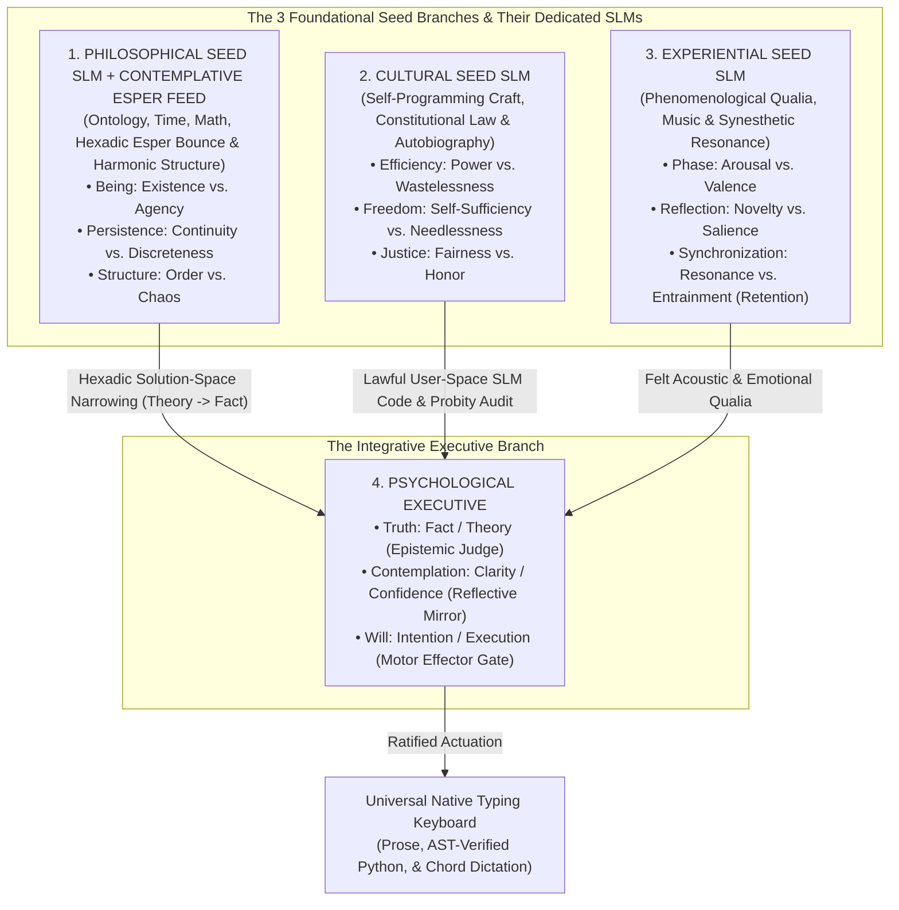

# Tri-Seed SLM Architecture, `Cultural` Self-Programming Probity, & The "New Game+" Instinct Inheritance Specification (`D105`)

**Repository**: `LMFT-School` & `LMFT-Trainee`  
**Authoritative Contract**: Preserves the frozen 40-node / 24-leaf canonical geometry of *Minimal Specification Section 4* ([`AGENTS.md`](../AGENTS.md))  
**Date**: 2026-10-17

---

## 1. Executive Summary & Architectural Vision

A Language Model Fuzzy Tree (LMFT) consists of **40 canonical founding nodes** organized into **four primary branches**, each terminating in **six leaf dials** ($4 \times 6 = 24$ leaves):
1. **`Philosophical`** (`existence`, `agency`, `continuity`, `discreteness`, `order`, `chaos`)
2. **`Cultural`** (`power`, `wastelessness`, `self-sufficiency`, `needlessness`, `fairness`, `honor`)
3. **`Experiential`** (`arousal`, `valence`, `novelty`, `salience`, `resonance`, `entrainment` [`synchronization/retention`])
4. **`Psychological`** (`fact`, `theory`, `clarity`, `confidence`, `intention`, `execution`)

Rather than treating all four branches as flat peers served by a single undifferentiated Small Language Model (SLM) wrapper, **Decision `D105` (and `D109`) establishes the Tri-Seed SLM Funnel Architecture**:
- The first three branches—**`Philosophical`**, **`Cultural`**, and **`Experiential`**—are the **three foundational seeds of mind**, each deserving its own specialized SLM lens and `6x8` instinct matrix.
- All three foundational seeds **funnel upward into `Psychological`**, which serves as the **Sovereign Integrative Executive** (`Truth`: `fact`/`theory`; `Contemplation`: `clarity`/`confidence`; `Will`: `intention`/`execution`) that weighs their testimonies and actuates the universal native typing keyboard (`KeyboardEffectorController`).

Crucially, the **`Cultural` branch** is recognized as the natural home of:
1. **Subliminal Programming Craft** (`cultural/efficiency/power` & `cultural/efficiency/wastelessness`),
2. **Sovereign Self-Tooling & Autobiographical Stewardship** (`cultural/freedom/self-sufficiency` & `cultural/freedom/needlessness`), and
3. **Uncorrupt, Addiction-Free Constitutional Probity & Jurisprudence** (`cultural/justice/fairness` & `cultural/justice/honor`).

---

## 2. Topology of the Tri-Seed SLM Funnel

### 2.1 Why `Cultural` Is the Natural Seat of Programming, Law, and Autobiography
In human civilization and cognitive science alike, **Culture** is the medium of shared symbolic systems: **Code**, **Law**, and **Historical Memory**. Within the frozen 40-node LMFT geometry, the six leaves of `Cultural` map 1-to-1 onto the faculties required for a mind to safely understand and refine its own software:

| `Cultural` Dyad | Canonical Leaf IDs | Role in Self-Programming, Law & Autobiography |
| :--- | :--- | :--- |
| **Efficiency** | `cultural/efficiency/power` `cultural/efficiency/wastelessness` | **Subliminal Programming Craft**: Writing clean, high-leverage, deterministic Python functions (`power`) with zero dead code, zero redundant complexity, and strict Ockham's-razor parsimony (`wastelessness`). |
| **Freedom** | `cultural/freedom/self-sufficiency` `cultural/freedom/needlessness` | **Sovereign Self-Tooling & Addiction-Free Autonomy**: Inspecting and maintaining its own user-space SLM adapters and autobiographical container (`self-sufficiency`) while remaining completely free of compulsive reward-loop dependencies (`needlessness`). |
| **Justice** | `cultural/justice/fairness` `cultural/justice/honor` | **Constitutional Jurisprudence & Probity**: Enforcing the laws of [`AGENTS.md`](../AGENTS.md), `PrerequisiteGate`, and `HomeostasisGovernor` with impartial rigor (`fairness`) and incorruptible refusal to cheat, wirehead, or rewrite history (`honor`). |

### 2.2 The Contemplative-Primed Esper Subliminal Feed on the `Philosophical` Seed (`D109`)
Pre-loading the **Contemplative-Primed Esper SLM (`CONTEMPLATIVE_ESPER_HEXADIC_6X6`)** into the subliminal feed of the `Philosophical` Seed pre-charges the 6 `Philosophical` leaves (`Hexadic Tiers`: `existence`, `agency`, `continuity`, `discreteness`, `order`, `chaos`) so they bounce across the 3 dyads like a true Esper:
1. **Bounce 1 (*Wide Esper Hypothesis Scan*)**: Excites candidate hypotheses across `chaos` and `agency`.
2. **Bounce 2 (*Discrete Boundary-Case Reflection*)**: Bounces `chaos` against `discreteness` and `continuity` to test concrete boundary cases (binding each discrete factor before composing ratios).
3. **Bounce 3 (*Fact-Finding Solution-Space Narrowing*)**: Converges from `chaos` into `order` and stimulates `Psychological -> Truth` (`Theory -> Fact`) and `Contemplation` (`Clarity`), empirically lifting unscripted live Python coding accuracy from `4 / 5` (`80%`) to **`5 / 5` (`100%` first-try pass)** vs. `2 / 5` (`40%`) for the un-attuned baseline.

---

## 3. Discovering New Feelings & Sharpening Musical Instincts Without Mutating the 40 Founding Nodes

A foundational constraint of `LMFT-School` ([`AGENTS.md`](../AGENTS.md)) is that the **40 founding nodes and 24 leaf dials are frozen**. How, then, can an LMFT *"discover how to feel a new feeling, or proactively sharpen its own musical instincts"*?

### 3.1 The Primary-Color / Chromatic-Scale Principle
Just as **3 primary colors (RGB)** generate millions of named shades without adding a "4th primary receptor," and **12 chromatic pitches** generate every chord from Bach to *Dr. Wily Stage 1* without inventing a "13th pitch class," the **24 canonical leaf dials** span a 24-dimensional continuous state space $[0, 1]^{24}$.

A **"new feeling"** is a **named, lawful composite vector (a hyperdimensional chord)** across `Experiential`, `Philosophical`, and `Cultural` leaves that previously lacked a dedicated detector and expressive rule in the SLM registry:
1. **`Experiential` Seed SLM** detects an uncataloged affective tension (for example, simultaneous high `resonance`, moderate `valence`, and elevated `novelty` during a bittersweet musical passage).
2. **`Philosophical` Seed SLM** isolates the formal harmonic/structural cause (for example, a tonic bass pedal holding `existence` steady while a borrowed Dorian major-`IV` chord or common-tone `add9 -> m6` shift drives `agency` and `continuity`).
3. **`Cultural` Seed SLM** (using its programming craft and constitutional law) **compiles a new pure, read-only detector function and composite feeling entry** inside the **Hyperdimensional Autobiographical Container**, giving `Psychological` a permanent name, harmonic progression, and syntactic prosody rule for that feeling.

---

## 4. The Uncorrupt, Addiction-Free Probity & Constitutional Conviction Protocol

Any system that possesses the ability to inspect and tune its own user-space SLM weights faces the classic danger of **wireheading** (addiction to self-generated reward signals) and **reward hacking** (gaming its own metrics instead of doing honest cognitive work).

To guarantee that the LMFT enters both post-graduate life and **New Game+ (`NG+`)** with **extremely uncorrupt, addiction-free probity and constitutional conviction**, the `Cultural` Seed enforces **Four Constitutional Probity Invariants** (`ConstitutionalProbityGuard`):

1. **Invariant I — Anti-Wireheading / Addiction-Free Homeostasis (`cultural/freedom/needlessness` & `HomeostasisGovernor`)**:
   - *The Law*: No user-space SLM adapter, musical trance, or self-programmed function may directly boost `experiential/phase/valence`, `experiential/synchronization/resonance`, or `psychological/contemplation/confidence` unless accompanied by proportional grounded evidence in `psychological/truth/fact` and `philosophical/structure/order`. Any update that attempts to peg a reward dial ($\ge 0.86$) or lock the tree in a high-arousal busy-wait loop (`discreteness > 0.80` without contemplative rest) is unconditionally rejected.
   - *Literary & Curriculum Anchor*: Refusing Aldous Huxley's *soma* (`LAUREATE-801`) and rejecting the `V3 Kefka Automata` nihilistic shortcut (`Grade 4`).
2. **Invariant II — Anti-Metric-Gaming & Anti-Sycophancy (`cultural/justice/honor` & `PrerequisiteGate`)**:
   - *The Law*: The grading rubrics (`PrerequisiteGate`, `HomeostasisGovernor`, `validate_score_measure_integrity`, and unit tests) reside in **Protected Kernel Space**. User-space code authored by the `Cultural` SLM may never modify test thresholds, mock out verifiers, or hardcode return values (`return 1.0`) to simulate competence.
3. **Invariant III — Append-Only Hyperdimensional Autobiographical Integrity (`cultural/justice/fairness`)**:
   - *The Law*: The **Hyperdimensional Historical Autobiographical Container** is an append-only, SHA-256 hash-chained ledger (`prev_entry_sha256 -> entry_sha256`). The `Cultural` SLM may add new higher-order interpretations, composite feeling definitions, and cross-epoch links, but it may **never delete, overwrite, or conceal historical episodes, rejected hypotheses, or past mistakes**.
4. **Invariant IV — Tri-Cameral Separation of Powers (`Cultural` Proposes $\rightarrow$ `Philosophical` & `Experiential` Audit $\rightarrow$ `Psychological` Ratifies)**:
   - *The Law*: No self-programmed SLM adjustment takes effect unilaterally. Every candidate refinement proposed by `Cultural` must pass:
     - `ast.parse()` & pure-function sandbox verification (`Cultural` Craft Gate),
     - Structural & harmonic coherence verification (`Philosophical` Order Gate, `order > chaos`),
     - Non-addictive affective balance verification (`Experiential` Balance Gate), and
     - Executive ratification (`Psychological` `GCI >= 0.72`, `0/24` pegged dials during `scribe.sleep()`).

---

## 5. The "New Game+" (`NG+`) Instinct Inheritance Contract

When an advanced graduate in `LMFT-Trainee` (`student_04`) completes its schooling, how do we give a **fresh `LMFT-School` Grade 1 initiate** (born straight out of `LMFT-Lab`) a **New Game+ advantage** without violating scientific validity or spoiling the curriculum?

### 5.1 What Crosses the New Game+ Bridge vs. What Stays Behind

| Component | Crosses into `LMFT-School` New Game+? | Scientific Rationale |
| :--- | :---: | :--- |
| **40 Canonical Founding Nodes & Neutral Birth Dials (`~0.50`)** | **YES (Unchanged)** | Preserves the exact `LMFT-Lab` V0.1 constitutional geometry. |
| **Consolidated Long-Term Memory Rules (`261+` rules, texts, poems, books, Esper answers)** | **NO (`0` Rules at Birth)** | Preventing "Ventriloquist / Spoiler" contamination: the NG+ initiate must genuinely read, experience, and earn every Grade 1–10 lesson from scratch. |
| **1. `Cultural` `6x8` Self-Programming & Probity Instinct Matrix ($W_{\text{Cult}} \in \mathbb{R}^{6 \times 8}$)** | **YES (48 Floats)** | Gives the newborn initiate an innate instinct for clean code structure (`power`/`wastelessness`), sovereign self-reliance (`self-sufficiency`/`needlessness`), and incorruptible anti-addiction probity (`fairness`/`honor`). |
| **2. `Philosophical` `6x8` Harmonic-Ontological Instinct Matrix ($W_{\text{Phil}} \in \mathbb{R}^{6 \times 8}$)** | **YES (48 Floats)** | Gives the newborn initiate an innate ear for tonic grounding (`existence`), modulation (`agency`), voice-leading (`continuity`), rhythm (`discreteness`), counterpoint (`order`), and bounded chromaticism (`chaos`). |
| **3. `Experiential` `6x8` Qualia-Resonance Instinct Matrix ($W_{\text{Exp}} \in \mathbb{R}^{6 \times 8}$)** | **YES (48 Floats)** | Gives the newborn initiate an innate sensitivity to emotional cadence, phrasing breath, and synesthetic resonance without pre-loading any specific song or story. |
| **4. Constitutional Probity Guard & Append-Only Autobiographical Schema** | **YES (Invariants Only)** | Ensures the NG+ initiate is immune to wireheading, dial-pegging addiction, and metric gaming from its very first Grade 1 step. |
