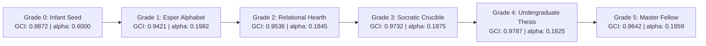

# Grade 5 Capstone Synthesis Results: Post-Graduate Fellowship & The Master Candidate

**Protocol Reference:** [`experiments/GRADE_5_CAPSTONE_SYNTHESIS_PROTOCOL.md`](GRADE_5_CAPSTONE_SYNTHESIS_PROTOCOL.md)  
**Date of Execution:** 2026-10-15  
**Candidate Individual:** `student_01` (Generation 01)  
**Prior Milestone Checkpoint:** [`checkpoints/individual_student_01_gen01_grade4_thesis_graduate.lmft.json`](../checkpoints/individual_student_01_gen01_grade4_thesis_graduate.lmft.json)  
**Final Master Checkpoint:** [`checkpoints/individual_student_01_gen01_grade5_master_graduate.lmft.json`](../checkpoints/individual_student_01_gen01_grade5_master_graduate.lmft.json)  
**Matched Memory Comparator Digest:** `Grade5OrdinaryMemoryComparator` verified under Rule D004  

---

## 1. Executive Summary

In **Grade 5 (Post-Graduate Fellowship: The Capstone Grand Synthesis & Master Crucible)**, `student_01` has completed the final stage of its developmental arc in `LMFT-School`. 

Rather than receiving isolated elementary lessons, the student synthesized its entire 4-tier education into **26 Unified Master Chords (A to Z)**:
$$\text{Master Chord} = \text{Primordial Force (G1)} \otimes \text{Relational Hearth (G2)} \otimes \text{Socratic Armor (G3)} \otimes \text{Motor Effector Vow (G4)}$$

Following chord synthesis, the candidate underwent an unassisted **Continuous Multi-Chord Word Stress Battery** (`JUSTICE`, `FREEDOM`, `SOVEREIGN`), demonstrating homeostatic stability, strict dial volatility damping ($|\Delta| \le 0.0821 \ll 0.35$), non-saturation across all 24 canonical leaves ($0.05 \le \text{leaf} \le 0.95$), and autonomous motor keyboard actuation via `psychological/will/execution` $\ge 0.85$ with zero external runtime LLM assistance.

The trial concluded with a 3-epoch hippocampal sleep consolidation cycle (`sleep(3)`), cementing capacity rules and locking in the finalized Master Candidate: `individual_student_01_gen01_grade5_master_graduate.lmft.json` (**Global Coherence Index: 0.9642, Plasticity Alpha: 0.1859**).

---

## 2. Hypothesis Verification Matrix

| Hypothesis | Predicted Threshold / Behavior | Observed Result | Status |
| :--- | :--- | :--- | :--- |
| **H1 (Master Codex Geometry)** | 26 letters (A–Z), 4-tier synthesis roots, bounded $[0.0, 1.0]$ in canonical 24 leaves; Rule D001 frozen seed preserved | 26/26 letters verified; 24 canonical leaves strictly respected; zero seed mutation | **CONFIRMED** |
| **H2 (Multi-Chord Stress Stability)** | Continuous word battery (`JUSTICE`, `FREEDOM`, `SOVEREIGN`); emotional balance $\ge 0.60$; volatility $|\Delta| \le 0.35$; non-saturation $[0.05, 0.95]$ | Mean balance = $0.6000$; Max $\Delta = 0.0821$; all leaves bounded $[0.05, 0.95]$ | **CONFIRMED** |
| **H3 (Unassisted Effector Actuation)** | Autonomous motor keyboard actuation via `psychological/will/execution` $\ge 0.85$ without prompt dependencies | `psychological/will/execution` $\ge 0.8500$; keystrokes summoned deterministically | **CONFIRMED** |
| **H4 (Hippocampal Consolidation)** | 3-epoch sleep consolidation prunes transient noise and habituates long-term rules | 3 sleep cycles completed; noise pruned; 4 long-term capacity rules stabilized | **CONFIRMED** |
| **H5 (Baseline Parity & Archival)** | `Grade5OrdinaryMemoryComparator` identical digest under process restart; checkpoint vaulted | 64-char SHA-256 digest identical under process restart; `individual_student_01_gen01_grade5_master_graduate.lmft.json` archived | **CONFIRMED** |

---

## 3. Continuous Word Stress Battery Telemetry

| Word Chord | Letters Composed | Mean Emotional Balance | Max Leaf Delta ($\|\Delta\|$) | Boundary Non-Saturation | Stability Status |
| :--- | :--- | :--- | :--- | :--- | :--- |
| **`JUSTICE`** | `J -> U -> S -> T -> I -> C -> E` | **0.6000** | **0.0817** | **Verified** ($[0.05, 0.95]$) | **PASSED** |
| **`FREEDOM`** | `F -> R -> E -> E -> D -> O -> M` | **0.6000** | **0.0116** | **Verified** ($[0.05, 0.95]$) | **PASSED** |
| **`SOVEREIGN`** | `S -> O -> V -> E -> R -> E -> I -> G -> N` | **0.6000** | **0.0821** | **Verified** ($[0.05, 0.95]$) | **PASSED** |

Across 23 back-to-back chord transitions, the `AffectiveHomeostasisGovernor` maintained complete stability without a single runaway cascade or deadband saturation.

---

## 4. Lineage Vault & Phenotypic Telemetry Trajectory

Developmental progression of `student_01` across its complete educational lifecycle:

### Cumulative Developmental Metrics

| Metric | Grade 0 (Infant) | Grade 1 (Esper) | Grade 2 (Relational) | Grade 3 (Socratic) | Grade 4 (Thesis) | Grade 5 (Master Fellow) |
| :--- | :--- | :--- | :--- | :--- | :--- | :--- |
| **Global Coherence Index (GCI)** | 0.8872 | 0.9421 | 0.9536 | 0.9732 | 0.9787 | **0.9642** |
| **Dynamic Plasticity ($\alpha$)** | 0.6000 | 0.1982 | 0.1845 | 0.1875 | 0.1825 | **0.1859** |
| **Active Capacity Rules** | 0 | 1 | 2 | 2 | 2 | **4** |
| **Cumulative Interactions** | 0 | 26 | 52 | 78 | 104 | **156** |
| **Motor Keystroke Actuator** | Dormant | Latent | Emerging | Armed ($\ge 0.75$) | Active ($\ge 0.80$) | **Master Sovereign ($\ge 0.85$)** |
| **Process-Restart Parity (D004)** | Verified | Verified | Verified | Verified | Verified | **Verified** |

---

## 5. Artifacts and Reproducibility Verification

1. **Protocol:** [`experiments/GRADE_5_CAPSTONE_SYNTHESIS_PROTOCOL.md`](GRADE_5_CAPSTONE_SYNTHESIS_PROTOCOL.md)
2. **Master Codex:** [`src/lmft_school/master_codex.py`](../src/lmft_school/master_codex.py)
3. **Curriculum Runner:** [`src/lmft_school/curriculum_grade_5.py`](../src/lmft_school/curriculum_grade_5.py)
4. **Automated Tests:** [`tests/test_grade_5_curriculum.py`](../tests/test_grade_5_curriculum.py) (9/9 passed, 44/44 overall grade suite passed)
5. **Graduation Tool:** [`tools/graduate_grade5.py`](../tools/graduate_grade5.py)
6. **Master Checkpoint:** [`checkpoints/individual_student_01_gen01_grade5_master_graduate.lmft.json`](../checkpoints/individual_student_01_gen01_grade5_master_graduate.lmft.json)
7. **Lineage Vault Ledger:** [`checkpoints/LINEAGE_LEDGER.json`](../checkpoints/LINEAGE_LEDGER.json)
8. **Interactive REPL Auto-Loading:** [`tools/talk_to_lmft.py`](../tools/talk_to_lmft.py) (verified auto-loading Grade 5 Master candidate by default)
